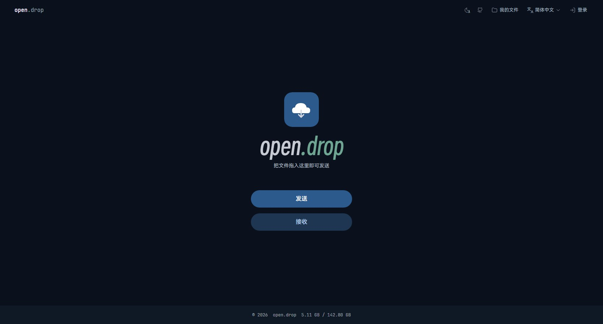

# open.drop

[English](#english)

[](demo_pic.jpg)

自托管的临时文件中转站，仿 [AirPortal 空投快传](https://airportal.cn)。拖入文件或文本即可发送，对方输入 6 位取件码就能下载。整个服务是一个 Rust 静态程序，Docker 一键部署，1 GB 内存的小 VPS 也能稳定运行。

## 特性

- 拖拽、粘贴或选择文件和文件夹（保留目录结构），也可以直接发送一段文本
- 6 位取件码，可选密码、下载次数和有效期；分享链接 `/d/取件码` 打开的是取件页，附二维码
- 多个文件可打包成一个 zip 下载（边读边发，不占额外磁盘），下载支持断点续传
- 账号可选：任意用户名加密码即自动注册，7 天有效可续期，用来管理自己发出的包裹
- 管理后台 `/admin`：磁盘占用、所有包裹和账号、在线调整限额，无需重启
- 存储上限按磁盘百分比或固定大小设置，并始终给系统留出余量
- 取件码防猜测限速、跨站请求防护、严格的安全响应头；容器以普通用户和只读根文件系统运行
- 中文和英文界面，浅色和深色主题

## 安装

需要 Linux（amd64 或 arm64）和 root 权限。没有 Docker 时脚本会通过 get.docker.com 自动安装。

```bash
curl -fsSL https://raw.githubusercontent.com/MrTangLuyao/opendrop/main/install.sh | sudo bash
```

使用域名并自动申请 HTTPS 证书（由 Caddy 完成，需要先把域名解析到服务器，并放行 80 和 443 端口）：

```bash
curl -fsSL https://raw.githubusercontent.com/MrTangLuyao/opendrop/main/install.sh | sudo bash -s -- --domain drop.example.com
```

HTTPS 模式下 Caddy 使用宿主机网络，能拿到访客真实的 IPv4 和 IPv6 地址（限速按地址计算）；opendrop 只监听本机 `127.0.0.1:8080`，这个端口被占用时自动换一个空闲端口。不用域名时同时监听 IPv4 和 IPv6（Docker 不支持 IPv6 网络时只监听 IPv4）。

安装结束时会显示一次管理员账号和随机密码，请记下来。只有这里会显示，日志里没有；忘记了用 `opendrop password` 重置。

| 选项 | 说明 |
|---|---|
| `--domain D` | 为域名 D 启用 HTTPS（Caddy 自动证书） |
| `--port P` | 端口，默认 80；用 `--domain` 时是 Caddy 转发到的本机端口，默认 8080 |
| `--dir PATH` | 安装目录，默认 `/opt/opendrop`；必须不存在、为空或者是已有的 opendrop 安装目录 |
| `--build` | 从源码构建镜像而不是拉取（默认镜像拉取失败时也会自动构建） |
| `-y`, `--yes` | 不提问，全部使用默认值 |

脚本可以重复运行：不带 `--domain` 或 `--port` 时保留现有设置，只做升级，数据保留不动。动手之前会先检查安装目录、端口和镜像，任何一项不满足就直接退出，什么都不改。在终端里直接运行且没有给出选项时，会询问域名和端口。

```
/opt/opendrop/
  compose.yml  .env     Docker Compose 配置和设置
  Caddyfile    caddy/   HTTPS 模式下的 Caddy 配置和证书
  data/                 数据库 opendrop.db 和所有文件
```

备份：`opendrop stop` 后用 `cp -a` 复制 `data/` 目录（保留属主和权限），再 `opendrop start`。恢复：`opendrop stop`，用备份替换 `data/`，再运行一次安装命令，它会把 `data/` 里的文件属主改回服务用户 10001。

## 管理命令

| 命令 | 作用 |
|---|---|
| `opendrop status [--json]` | 容器状态、健康检查、存储用量 |
| `opendrop logs [-f]` | 最近 200 行日志，`-f` 持续输出 |
| `opendrop start`，`stop`，`restart` | 启动、停止、重启 |
| `opendrop update` | 拉取最新镜像并重启 |
| `opendrop password [P]` | 重置管理员密码，不填则随机生成 |
| `opendrop uninstall [--purge]` | 删除容器、镜像、这个命令和安装脚本写的配置文件；默认保留 `data/`，`--purge` 一并删除；安装目录里的其他文件不动 |

退出码：0 成功，1 失败，2 用法错误。

## 从 v1 升级

v1 是 Node.js 加 pm2 的版本。直接运行上面的安装命令。脚本发现 `/opt/opendrop` 是 v1（有 `server.js` 没有 `Cargo.toml`，或者 pm2 还在运行 opendrop）后，先确认端口空闲、镜像已经就绪，这期间 v1 照常运行，检查不通过就直接退出。然后：

1. 执行 `pm2 delete opendrop` 和 `pm2 save`
2. 把旧目录移到 `/opt/opendrop.v1-backup-<时间>`，替换旧的 `opendrop` 命令
3. 如果存在 v1 的 nginx 站点 `/etc/nginx/sites-enabled/opendrop` 且没有指定 `--domain`，保留 nginx 和它的证书，新容器监听 `127.0.0.1:3000`，nginx 不用改

注意：

- 旧的包裹和账号不会迁移（本来就是临时数据）。旧的 admin/admin 不再有效，请使用安装结束时显示的新密码。
- v1 的 nginx 配置把上传限制在 5G，需要更大的上传时把该文件里的 `client_max_body_size` 改成 `0`，再 `systemctl reload nginx`。
- 想改用内置的 Caddy：停用 nginx（或让它不再占用 80 和 443），然后带 `--domain` 重新运行安装命令。nginx 还占着这两个端口时脚本会直接退出，v1 不受影响。
- Node.js 和 pm2 不会被卸载，确认不再需要后可以自行删除，备份目录也一样。

## 配置

大部分设置在管理后台 `/admin` 里修改，立即生效：

| 设置 | 默认 | 说明 |
|---|---|---|
| 站点名称 | open.drop | 页面顶部、页脚和浏览器标题里显示的名字，1 到 32 个字符 |
| 存储上限 | 磁盘的 70% | 按磁盘百分比（1% 到 95%）或固定大小；所有包裹（包括上传中的）合计不超过它 |
| 单次上传上限 | 5 GiB | 一个包裹的总大小，最大为磁盘容量 |
| 最长有效期 | 168 小时 | 1 到 8760 小时 |
| 匿名上传 | 开 | 关闭后必须登录才能发送 |
| 允许注册 | 开 | 关闭后只有已有账号能登录 |

存储满了会拒绝新的上传，不会提前删除旧包裹。磁盘上还始终保留 512 MiB 或磁盘 1% 的空余（取较大者）。后台还能编辑或删除任意包裹，给账号续期、设为永久或删除，修改管理员的用户名和密码。

`/opt/opendrop/.env` 由安装脚本写入，修改后运行 `opendrop start` 生效：

| 变量 | 说明 |
|---|---|
| `OPENDROP_BIND`，`OPENDROP_PORT` | 宿主机监听地址和端口；地址为空表示所有 IPv4 和 IPv6 地址 |
| `OPENDROP_TRUST_PROXY` | 在反向代理后面时设为 `true` |
| `OPENDROP_IPV6`，`OPENDROP_ADDR` | 安装脚本检测后写入：容器网络是否开启 IPv6（开启后 IPv6 访客带着自己的地址进来），容器内的监听地址 |
| `DOMAIN`，`COMPOSE_PROFILES=https` | HTTPS 模式的域名和 Caddy 开关 |
| `OPENDROP_IMAGE` | 可选，固定镜像版本，例如 `ghcr.io/mrtangluyao/opendrop:2.0.0`；拉取失败时安装脚本报错退出（本机已有这个镜像时用本机的），不会改用源码构建 |

程序本身读取的环境变量（直接运行镜像或程序时使用）：

| 变量 | 默认 | 说明 |
|---|---|---|
| `OPENDROP_DATA` | 容器内 `/data`，否则 `./data` | 数据目录 |
| `OPENDROP_ADDR` | `0.0.0.0:8080` | 监听地址 |
| `OPENDROP_TRUST_PROXY` | `false` | 为 `true` 时客户端 IP 取 `X-Forwarded-For` 的最后一项，协议取 `X-Forwarded-Proto` |
| `OPENDROP_ADMIN_PASSWORD` | 随机 | 只在第一次创建管理员时使用；未设置时首次启动生成随机密码并打印在日志里（安装脚本在启动前自己创建管理员，所以它装的服务日志里没有密码） |
| `OPENDROP_SECURE_COOKIE` | `auto` | `auto`（HTTPS 时带 Secure），`true` 或 `false` |

## 反向代理

自己用 nginx 等反向代理时，让 opendrop 只监听本机：在 `.env` 里设置 `OPENDROP_BIND=127.0.0.1`、`OPENDROP_PORT=3000`、`OPENDROP_TRUST_PROXY=true`，运行 `opendrop start`，再关闭代理的缓冲和大小限制：

```nginx
server {
    listen 443 ssl;
    server_name drop.example.com;
    # ssl_certificate ...; ssl_certificate_key ...;

    client_max_body_size 0;
    proxy_request_buffering off;
    proxy_buffering off;
    proxy_read_timeout 1h;
    proxy_send_timeout 1h;
    send_timeout 1h;

    location / {
        proxy_pass http://127.0.0.1:3000;
        proxy_http_version 1.1;
        proxy_set_header Host $http_host;
        proxy_set_header X-Forwarded-For $proxy_add_x_forwarded_for;
        proxy_set_header X-Forwarded-Proto $scheme;
    }
}
```

`Host` 要原样转发，因为跨站检查会对比 `Origin` 和 `Host`。只支持一层代理：客户端 IP 取 `X-Forwarded-For` 的最后一项。

## 从源码构建

```bash
git clone https://github.com/MrTangLuyao/opendrop && cd opendrop

# Docker 镜像（静态 musl 程序，FROM scratch）
docker build -t opendrop .
docker run -d --name opendrop -p 80:8080 -v opendrop-data:/data opendrop

# 或者直接编译（Rust stable）
cargo build --release
./target/release/opendrop      # http://localhost:8080，数据在 ./data
```

这样直接运行时，首次启动生成的管理员密码在 `docker logs opendrop` 里。

在克隆的目录里运行 `sudo bash install.sh --build` 会用本地源码构建镜像，安装到 `/opt/opendrop`（克隆目录本身不能作为安装目录）。预构建镜像在 `ghcr.io/mrtangluyao/opendrop`（amd64 和 arm64，标签 `latest`、版本号、`sha-<提交>`）。

程序命令：`opendrop serve`（默认），`health`，`admin-reset [--password P] [--json]`，`status [--json]`，`version`。

## API

JSON 接口，错误返回 `{"error":"代码"}` 和对应的 HTTP 状态码。写操作必须同源，JSON 请求要带 `Content-Type: application/json`。

| 方法 | 路径 | 作用 |
|---|---|---|
| GET | `/api/info` | 公开限额和存储用量 |
| GET | `/healthz` | 健康检查 |
| GET | `/api/qr?u=...` | 二维码 SVG |
| POST | `/api/auth/login` | 登录，未知用户名自动注册 |
| POST | `/api/auth/logout` | 退出 |
| GET | `/api/auth/me` | 当前账号 |
| POST | `/api/auth/renew` | 账号续期 7 天 |
| POST | `/api/parcels` | 创建包裹（文件列表或文本） |
| PUT | `/api/parcels/{id}/files/{idx}` | 上传一个文件的内容（`X-Upload-Token`） |
| POST | `/api/parcels/{id}/finish` | 完成上传，返回取件码 |
| DELETE | `/api/parcels/{id}` | 取消上传 |
| POST | `/api/p/{code}` | 查看包裹（不消耗次数） |
| POST | `/api/p/{code}/claim` | 消耗一次下载，返回 1 小时有效的下载令牌 |
| GET | `/api/dl/{token}/{idx}` | 下载一个文件（支持 Range） |
| GET | `/api/dl/{token}/zip` | 全部文件打包下载 |
| GET，PATCH，DELETE | `/api/me/parcels`，`/api/me/parcels/{code}` | 我的包裹 |
| GET，PUT，PATCH，POST，DELETE | `/api/admin/overview`，`parcels`，`accounts`，`settings`，`credentials` | 管理接口 |

## 协议

MIT

---

<a id="english"></a>

# open.drop (English)

[](demo_pic.jpg)

A temporary file drop you host yourself, modelled on [AirPortal](https://airportal.cn). Drop in files or text to send them; the receiver types a 6 digit pickup code to download. The whole service is one static Rust binary, installed with one command on Docker, and runs fine on a 1 GB VPS.

## Features

- Drag, paste or pick files and folders (relative paths are kept), or send a piece of text
- 6 digit pickup code with optional password, download limit and expiry; the share link `/d/CODE` opens a pickup page, with a QR code
- Several files download as one zip (streamed, no extra disk), and downloads can resume
- Optional accounts: any username and password signs up automatically, valid 7 days and renewable, used to manage your own parcels
- Admin panel at `/admin`: disk usage, every parcel and account, limits editable live without a restart
- Storage limit as a percentage of the disk or a fixed size, always leaving headroom for the system
- Rate limited code lookups, cross site request protection, strict security headers; the container runs as an unprivileged user with a read only root filesystem
- Chinese and English UI, light and dark theme

## Install

Needs Linux (amd64 or arm64) and root. Docker is installed through get.docker.com when missing.

```bash
curl -fsSL https://raw.githubusercontent.com/MrTangLuyao/opendrop/main/install.sh | sudo bash
```

With a domain and automatic HTTPS (done by Caddy; point the domain at the server and open ports 80 and 443 first):

```bash
curl -fsSL https://raw.githubusercontent.com/MrTangLuyao/opendrop/main/install.sh | sudo bash -s -- --domain drop.example.com
```

In HTTPS mode Caddy uses the host network, so it sees the real IPv4 and IPv6 address of every visitor (rate limits work per address); opendrop listens on `127.0.0.1:8080` only, or on a free port when 8080 is taken. Without a domain opendrop listens on IPv4 and IPv6 (IPv4 only when Docker cannot create IPv6 networks).

The admin username and a random password are shown once at the end. Write them down: they appear nowhere else, not in the logs either. Lost them? `opendrop password` sets a new one.

| Option | Meaning |
|---|---|
| `--domain D` | serve HTTPS on domain D (Caddy, automatic certificates) |
| `--port P` | port, default 80; with `--domain` the loopback port Caddy forwards to, default 8080 |
| `--dir PATH` | install dir, default `/opt/opendrop`; it must be missing, empty or an existing opendrop install |
| `--build` | build the image from source instead of pulling it (also done automatically when the default image cannot be pulled) |
| `-y`, `--yes` | no prompts, accept defaults |

The script is safe to run again: without `--domain` or `--port` it keeps the current settings and only upgrades; data is kept. It checks the install dir, the ports and the image before it changes anything, and stops without changes when one of them fails. Run in a terminal without options, it asks for a domain and a port.

```
/opt/opendrop/
  compose.yml  .env     Docker Compose file and settings
  Caddyfile    caddy/   Caddy config and certificates (HTTPS mode)
  data/                 database opendrop.db and all files
```

Backup: `opendrop stop`, copy the `data/` directory with `cp -a` (it keeps owners and modes), then `opendrop start`. Restore: `opendrop stop`, put the copy back as `data/`, then run the install command again; it gives the files in `data/` back to the service user 10001.

## Commands

| Command | Does |
|---|---|
| `opendrop status [--json]` | container state, health, storage |
| `opendrop logs [-f]` | last 200 log lines, `-f` to follow |
| `opendrop start`, `stop`, `restart` | start, stop, restart |
| `opendrop update` | pull the latest image and restart |
| `opendrop password [P]` | reset the admin password, random when P is omitted |
| `opendrop uninstall [--purge]` | remove containers, images, this command and the config files the installer wrote; keeps `data/` unless `--purge`; other files in the install dir stay |

Exit codes: 0 ok, 1 failure, 2 usage error.

## Upgrade from v1

v1 was the Node.js and pm2 version. Run the install command above. When `/opt/opendrop` holds v1 (a `server.js` without `Cargo.toml`, or pm2 still runs opendrop), the script first makes sure the ports are free and the image is ready; v1 keeps running meanwhile, and a failed check stops the script. Then it will:

1. run `pm2 delete opendrop` and `pm2 save`
2. move the old directory to `/opt/opendrop.v1-backup-<time>` and replace the old `opendrop` command
3. if the v1 nginx site `/etc/nginx/sites-enabled/opendrop` exists and no `--domain` is given, keep nginx and its certificates and run the container on `127.0.0.1:3000`, so nginx needs no change

Notes:

- Old parcels and accounts are not migrated (they were temporary anyway). The old admin/admin login is gone; use the new password shown at the end of the install.
- The v1 nginx config caps uploads at 5G. For bigger uploads set `client_max_body_size 0;` in that file and run `systemctl reload nginx`.
- To switch to the bundled Caddy, stop nginx (or free ports 80 and 443) and run the install command again with `--domain`. While nginx still holds those ports the script stops and v1 is left alone.
- Node.js and pm2 are not removed; delete them, and the backup directory, once you no longer need them.

## Configuration

Most settings live in the admin panel at `/admin` and apply immediately:

| Setting | Default | Notes |
|---|---|---|
| Site name | open.drop | the name in the page header, the footer and the browser title, 1 to 32 characters |
| Storage limit | 70% of the disk | a percentage of the disk (1% to 95%) or a fixed size; all parcels together, uploads in progress included |
| Max upload | 5 GiB | total size of one parcel, at most the disk size |
| Max expiry | 168 hours | 1 to 8760 hours |
| Anonymous uploads | on | when off, sending requires signing in |
| Sign ups | on | when off, only existing accounts can sign in |

When storage is full new uploads are refused; old parcels are never deleted early. A reserve of 512 MiB or 1% of the disk (whichever is larger) is always kept free. The panel also edits or deletes any parcel, renews, makes permanent or deletes accounts, and changes the admin username and password.

`/opt/opendrop/.env` is written by the installer; run `opendrop start` after editing it:

| Variable | Meaning |
|---|---|
| `OPENDROP_BIND`, `OPENDROP_PORT` | host address and port; an empty address means every IPv4 and IPv6 address |
| `OPENDROP_TRUST_PROXY` | `true` behind a reverse proxy |
| `OPENDROP_IPV6`, `OPENDROP_ADDR` | set by the installer: IPv6 on the container network (IPv6 visitors then arrive with their own address), and the listen address inside the container |
| `DOMAIN`, `COMPOSE_PROFILES=https` | HTTPS mode: domain and the Caddy switch |
| `OPENDROP_IMAGE` | optional, pin an image version, for example `ghcr.io/mrtangluyao/opendrop:2.0.0`; when it cannot be pulled the installer stops with an error (or uses a local copy of that image), it never builds from source instead |

Environment read by the binary itself (when running the image or the binary directly):

| Variable | Default | Meaning |
|---|---|---|
| `OPENDROP_DATA` | `/data` in the container, else `./data` | data directory |
| `OPENDROP_ADDR` | `0.0.0.0:8080` | listen address |
| `OPENDROP_TRUST_PROXY` | `false` | when `true`, the client IP is the last `X-Forwarded-For` entry and the scheme comes from `X-Forwarded-Proto` |
| `OPENDROP_ADMIN_PASSWORD` | random | used only when the admin account is first created; when unset the first start logs a random password (the installer creates the admin itself before the first start, so its logs hold no password) |
| `OPENDROP_SECURE_COOKIE` | `auto` | `auto` (Secure on HTTPS), `true` or `false` |

## Reverse proxy

Behind your own nginx or similar, let opendrop listen on loopback only: set `OPENDROP_BIND=127.0.0.1`, `OPENDROP_PORT=3000` and `OPENDROP_TRUST_PROXY=true` in `.env`, run `opendrop start`, and turn off buffering and size limits in the proxy:

```nginx
server {
    listen 443 ssl;
    server_name drop.example.com;
    # ssl_certificate ...; ssl_certificate_key ...;

    client_max_body_size 0;
    proxy_request_buffering off;
    proxy_buffering off;
    proxy_read_timeout 1h;
    proxy_send_timeout 1h;
    send_timeout 1h;

    location / {
        proxy_pass http://127.0.0.1:3000;
        proxy_http_version 1.1;
        proxy_set_header Host $http_host;
        proxy_set_header X-Forwarded-For $proxy_add_x_forwarded_for;
        proxy_set_header X-Forwarded-Proto $scheme;
    }
}
```

Pass `Host` through unchanged: the cross site check compares `Origin` with `Host`. One proxy layer is supported: the client IP is the last `X-Forwarded-For` entry.

## Build from source

```bash
git clone https://github.com/MrTangLuyao/opendrop && cd opendrop

# Docker image (static musl binary, FROM scratch)
docker build -t opendrop .
docker run -d --name opendrop -p 80:8080 -v opendrop-data:/data opendrop

# or build the binary (Rust stable)
cargo build --release
./target/release/opendrop      # http://localhost:8080, data in ./data
```

Run this way, the admin password generated on the first start is in `docker logs opendrop`.

`sudo bash install.sh --build` inside the clone builds the image from the local source and installs it to `/opt/opendrop` (the clone itself cannot be the install dir). Prebuilt images: `ghcr.io/mrtangluyao/opendrop` (amd64 and arm64; tags `latest`, version numbers, `sha-<commit>`).

Binary commands: `opendrop serve` (default), `health`, `admin-reset [--password P] [--json]`, `status [--json]`, `version`.

## API

JSON over HTTP; errors are `{"error":"code"}` with a matching status. Writes must be same origin, and JSON requests need `Content-Type: application/json`.

| Method | Path | Purpose |
|---|---|---|
| GET | `/api/info` | public limits and storage use |
| GET | `/healthz` | health check |
| GET | `/api/qr?u=...` | QR code SVG |
| POST | `/api/auth/login` | sign in; unknown usernames sign up |
| POST | `/api/auth/logout` | sign out |
| GET | `/api/auth/me` | current account |
| POST | `/api/auth/renew` | extend the account by 7 days |
| POST | `/api/parcels` | create a parcel (file list or text) |
| PUT | `/api/parcels/{id}/files/{idx}` | upload one file's bytes (`X-Upload-Token`) |
| POST | `/api/parcels/{id}/finish` | finish the upload, returns the pickup code |
| DELETE | `/api/parcels/{id}` | cancel an upload |
| POST | `/api/p/{code}` | parcel info (does not use a download) |
| POST | `/api/p/{code}/claim` | use one download, returns a download token valid 1 hour |
| GET | `/api/dl/{token}/{idx}` | download one file (Range supported) |
| GET | `/api/dl/{token}/zip` | download all files as one zip |
| GET, PATCH, DELETE | `/api/me/parcels`, `/api/me/parcels/{code}` | my parcels |
| GET, PUT, PATCH, POST, DELETE | `/api/admin/overview`, `parcels`, `accounts`, `settings`, `credentials` | admin |

## License

MIT
